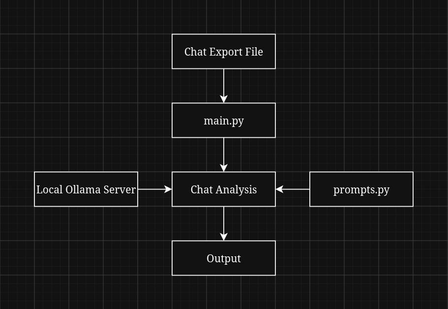

# NAVI Chat Analyst

NAVI Chat Analyst is an Ollama-based chat analysis engine built with Python.

## How it works

NAVI Chat Analyst accepts 4 different arguments:

- `--chat` to specify the chat export file that will be analyzed (`.txt` or `.json`)
- `--model` to specify the model that will be used (must be installed locally)
- `--mode` to specify the analysis mode (default mode is `Default`)
- `--context` to specify the context window for the model (default is `8192`)

It uses an Ollama model to analyze the chat with pre-made prompts for different modes and then streams the output in real time.

## Logic


## Features

- Fully local & no internet required
- Flexible chat analysis with different modes
- Supports different chat text files
- Works with any Ollama model installed locally
- Streams the analysis output in real time

## Libraries

- [Ollama](https://pypi.org/project/ollama/)
- `argparse` (included in Python)
- `pathlib` (included in Python)

## Usage examples

Basic analysis:

```bash
python main.py --chat /path-to-file/export.json --model ai-model
```

Analysis with a specific mode and context size:

```bash
python main.py --chat /path-to-file/export.json --model ai-model --mode Business --context 4096
```