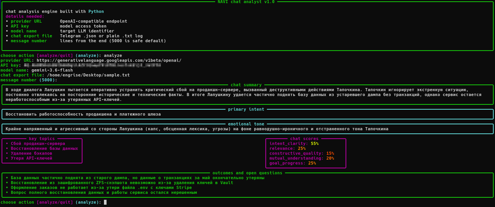

# NAVI Chat Analyst

<p align="left">
  
  
  
  
  
</p>

CLI engine for structural communication analysis via OpenAI-compatible LLM endpoints. Ingests raw chat logs, enforces strict JSON serialization via Pydantic v2, and renders quantified conversational metrics using `rich`.



---

## Architecture

```text
[Telegram JSON / Plain TXT]
            │
            ▼
      chat_parse()         --> Normalizes senders, timestamps, and lines
            │
            ▼
       analyze()           --> Tail-slices last N lines, temp=0.2, json_object mode
            │
            ▼
    OutputSchema (Pydantic)--> Validates types, ranges, extra="forbid"
            │
            ▼
      chat_output()        --> Renders terminal cards and 0–100 scalar gradients
```

---

## Installation

```bash
pip install openai pydantic rich
```

---

## Configuration & Execution

Run the entry point:

```bash
python main.py
```

### 1. Session Parameters (Prompted on Startup)
Collected once prior to the analysis loop:
- **Provider URL:** OpenAI-compatible endpoint base (`https://api.openai.com/v1`, `http://localhost:11434/v1`, etc.).
- **API Key:** Bearer token / API key.
- **Model Name:** Target LLM model identifier (`gpt-4o-mini`, `gemini-2.5-flash`, `qwen2.5:72b`, etc.).

### 2. Analysis Parameters (Prompted per Run)
- **Chat export file:** Relative or absolute path to a Telegram export (`result.json`) or plain log (`.txt`). A preconfigured test dialogue is included: `sample_chat.txt`.
- **Message number:** Number of tail lines evaluated from the end of the log (default: `5000`).

---

## Validation Contract (Pydantic v2)

Responses are constrained to raw JSON matching the following contract:

```json
{
  "summary": "string (2-4 sentences, strictly factual overview)",
  "primary_intent": "string (initiator target objective)",
  "key_topics": ["string (1-3 words each, 1 to 5 items)"],
  "emotional_tone": "string (derived exclusively from vocabulary and tone)",
  "outcomes_and_open_questions": ["string (tangible results / pending issues, 1 to 5 items)"],
  "scores": {
    "intent_clarity": 0,
    "relevance": 0,
    "constructive_quality": 0,
    "mutual_understanding": 0,
    "goal_progress": 0
  }
}
```

All metrics in `scores` are enforced as integer values in the range `[0, 100]`.

---

## Project Structure

```text
├── main.py         # Entry point, session credential init, interactive loop
├── logic.py        # Log parsers (JSON/TXT), tail slicer, LLM call pipeline
├── model_data.py   # Pydantic schemas (Scores, OutputSchema), system prompt
├── output.py       # Rich terminal renderers, score color-mapping
└── sample_chat.txt # Bundled test dialogue (200-line incident transcript)
```

---

## License

MIT